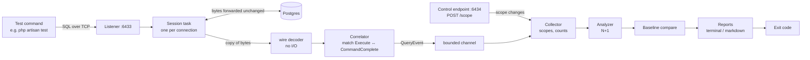

# Architecture Proposal (v0.1)

## Style

One Cargo package (a binary with a library inside), plain modules, no services, no plugins.
Keep `wire` free of I/O so it could become its own crate later — but do not split crates in v0.1.

## Big picture



## Process lifecycle (`record` / `check`)

1. Load config (`querybudget.toml` + CLI flags).
2. Bind proxy listener and control endpoint (fail fast with exit code 4).
3. Spawn the test command as a child process (inherits stdout/stderr).
4. Accept connections until the child exits.
5. Graceful shutdown: stop accepting, give open sessions a short drain time, close the channel.
6. Collector finishes → analyzer → compare (check) or write baseline (record) → report → exit code.

## One connection, in detail

```text
client socket ──read──▶ [buffer] ──write_all──▶ upstream socket     (frontend task)
                           │
                           └─▶ FrontendDecoder → Query/Parse/Bind/Execute/Close/Sync
                                   │ pending executions (FIFO) via channel
                                   ▼
upstream socket ──read──▶ [buffer] ──write_all──▶ client socket     (backend task)
                           │
                           └─▶ BackendDecoder → CommandComplete/ErrorResponse/ReadyForQuery
                                   → pop matching pending execution → QueryEvent
```

- **Forward first, then decode.** The decoder sees a copy of the bytes. Forwarding never waits for analysis.
- **Two tasks per connection** (client→server, server→client). Postgres answers requests in order on one connection, so the frontend task pushes "expected results" into a FIFO and the backend task pops them.
- **Statement map** (per connection): prepared statement name → SQL, portal name → statement name. Unnamed statement/portal (`""`) is overwritten on each `Parse`/`Bind`.
- **If decoding fails:** log one warning, stop decoding that connection, keep forwarding.
- **Startup phase** is special: no type byte; handle `SSLRequest` / `GSSENCRequest` by replying `N` directly; forward `CancelRequest` and the real `StartupMessage` untouched. See `PROTOCOL_NOTES.md`.

## Module layout

```text
querybudget/
├── Cargo.toml
├── querybudget.toml.example
├── docker-compose.yml          # local Postgres for development/tests
├── action.yml                  # GitHub Action (Phase 4)
├── src/
│   ├── main.rs                 # parse CLI, call into lib, map errors → exit codes
│   ├── lib.rs
│   ├── cli.rs                  # clap definitions (record, check)
│   ├── config.rs               # config file + flags, validation
│   ├── error.rs                # typed errors
│   ├── wire/                   # NO I/O. bytes → typed messages
│   │   ├── mod.rs
│   │   ├── buffer.rs           # incremental framing (partial messages)
│   │   ├── startup.rs          # StartupMessage, SSLRequest, CancelRequest…
│   │   ├── frontend.rs         # client → server messages
│   │   └── backend.rs          # server → client messages
│   ├── proxy/
│   │   ├── mod.rs              # listener, accept loop, shutdown
│   │   ├── session.rs          # two forwarding tasks per connection
│   │   └── correlate.rs        # statement map, pending FIFO, QueryEvent creation
│   ├── normalize.rs            # SQL → normalized text + fingerprint
│   ├── collector.rs            # scopes, counts per fingerprint
│   ├── analyze.rs              # N+1 detection
│   ├── baseline.rs             # read/write/compare baseline file
│   ├── control.rs              # loopback HTTP endpoint for scopes
│   ├── runner.rs               # spawn test command, wait, exit code
│   └── report/
│       ├── mod.rs
│       ├── terminal.rs
│       └── markdown.rs
├── tests/                      # integration tests (real Postgres)
│   ├── fixtures/               # captured byte fixtures
│   └── *.rs
├── examples/
│   └── laravel-demo/           # Phase 4
├── docs/                       # public project docs + docs/adr/
└── agent/                      # agent instructions, tasks, planning, learning (not shipped)
```

Full repository layout: see "Repository layout" in `README.md`.

## Key types (sketch, not final)

```text
QueryEvent      { connection_id, scope (filled by collector), sql, kind: Simple|Extended,
                  outcome: Ok{tag, rows}|Error{sqlstate}, duration }
Normalized      { text, fingerprint: u64 }
ScopeStats      { name, total, by_fingerprint: BTreeMap<Fingerprint, FingerprintStats> }
FingerprintStats{ normalized_sql, count }
Baseline        { format_version: 1, tool_version, settings_summary,
                  scopes: BTreeMap<String, ScopeBaseline> }
Finding         { scope, kind: CountIncrease{from,to} | NewNPlusOne{fingerprint,count}
                          | NewScope | RemovedScope | CountDecrease }
```

`BTreeMap` (not `HashMap`) wherever output order matters → deterministic files and reports.

## Scopes

- Default: a single scope named `(run)`.
- Per-test mode: the test suite calls the control endpoint:
  - `POST http://127.0.0.1:6434/scope` with body `{"name": "OrdersTest::test_index"}` → starts a scope
  - `POST http://127.0.0.1:6434/scope/end` → ends it
- Queries outside any scope (e.g. migrations at suite start) go into `(unscoped)`, which is reported but **not checked** by default.
- v0.1 limitation: one active scope at a time (global), so per-test mode requires a serial test run.

## Candidate dependencies (v0.1)

| Concern | Crate | Why / alternative |
|---|---|---|
| Async runtime | `tokio` | Standard; needed for sockets, tasks, process, signals |
| Byte buffers | `bytes` | Cheap slicing of network buffers; alternative: `Vec<u8>` (more copying) |
| CLI | `clap` (derive) | Standard; alternative: `argh` |
| Serialization | `serde`, `serde_json` | Baseline file + JSON |
| Config | `toml` | `querybudget.toml` |
| Errors | `thiserror` (lib), `anyhow` (main) | Typed errors inside, simple reporting at the edge |
| Logging | `tracing`, `tracing-subscriber` | Structured logs |
| Control endpoint | `axum` | Tiny HTTP server; alternative: hand-written line protocol (less friendly for users) |
| Test client (dev) | `tokio-postgres` | Drives simple + extended protocol in integration tests |
| Snapshot tests (dev) | `insta` | Report output tests |
| Temp files (dev) | `tempfile` | Baseline tests |

Not used in v0.1: `pg_query` (C dependency; our own normalizer is enough for v0.1 — see ADR 0003),
`tokio-util` codecs (we never re-encode; a small framing buffer is simpler and teaches more).

## Important design decisions

1. Observe-only forwarding (ADR 0001).
2. Postgres only, plain TCP, local/CI only (ADR 0002).
3. Own lightweight normalizer, not `pg_query`, for v0.1 (ADR 0003).
4. Baseline is a committed, sorted JSON file (ADR 0004).
5. AI is not part of v0.1; any future AI is optional and advisory (ADR 0005).
6. Bounded event channel. In `check`/`record` mode the proxy applies backpressure instead of
   dropping events, because missing events would make counts wrong. Forwarding of bytes still
   happens before the event is sent.
